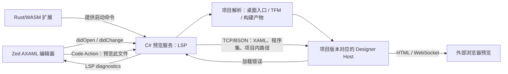

# Zed Avalonia 预览插件可行性调研

调研日期：2026-10-12。范围：公开官方文档、公开源码及归档源码；未开发插件、未启动预览器，也未验证用户安装的 Zed 版本。当前工作目录为空，因此在 `docs/research/` 保存报告。

## 结论

可以实现“在 Zed 编辑 Avalonia AXAML，并在外部浏览器/独立窗口查看设计时预览”。可以进一步通过独立的 LSP 服务同步未保存文本，做到边输入边预览；这条路线有源码依据，但仍需端到端原型确认。

仅使用目前公开的 Zed 扩展 API，不能承诺实现 VS Code 那种编辑器内嵌、左右分栏的交互预览面板。公开 API 缺少自定义视图/Webview 注册入口，相关需求仍处于 Open 状态。内嵌方案需要 Zed 核心支持或维护定制版本。[Zed 扩展文档](https://zed.dev/docs/extensions/developing-extensions)、[Extension trait](https://github.com/zed-industries/zed/blob/93d745668805029476e6d7fbb19652116fed51de/crates/extension_api/src/extension_api.rs)、[Webview 扩展需求 #21208](https://github.com/zed-industries/zed/issues/21208)

建议先做“Task 启动 + 外部浏览器 + 保存刷新”的技术验证，再做“Zed 扩展 + C# LSP 预览服务 + 未保存文本同步”的 MVP。不要把修改 Zed 本体作为第一阶段前提。

## 一、VS Code 插件可以参考哪些部分

现行 Avalonia for VS Code 提供免费 Community 版，其中包含 XAML 预览；官方明确说明现行扩展本身不开源。官方 GitHub 仓库将旧源码保留在 `ARCHIVE` 分支，旧版本根目录 LICENSE 为 MIT。不能把“免费使用”理解为可以提取现行扩展中的服务器或其他二进制并重新分发。复用归档代码时应保留许可，并单独核对所选子模块和依赖的许可。[现行产品说明及 FAQ](https://avaloniaui.net/vscode)、[归档仓库](https://github.com/AvaloniaUI/AvaloniaVSCode/tree/ARCHIVE)、[归档 LICENSE](https://github.com/AvaloniaUI/AvaloniaVSCode/blob/d0e5d9c7cddf70d67985fb30c8ebf1bf3f5bcb4e/LICENSE)

归档实现的职责划分：

1. 解析解决方案和项目，定位编译产物、runtimeconfig、deps 和 Designer Host。
2. 启动 .NET Designer Host，通过 TCP/BSON 发送 XAML 更新。
3. 使用 Host 的 HTML 模式提供预览页面。
4. VS Code Webview 中用 iframe 展示该页面。

代码证据：[previewerProcess.ts](https://github.com/AvaloniaUI/AvaloniaVSCode/blob/d0e5d9c7cddf70d67985fb30c8ebf1bf3f5bcb4e/src/vscode-avalonia/src/commands/previewerProcess.ts)、[previewServer.ts](https://github.com/AvaloniaUI/AvaloniaVSCode/blob/d0e5d9c7cddf70d67985fb30c8ebf1bf3f5bcb4e/src/vscode-avalonia/src/services/previewServer.ts)、[WebPreviwerPanel.ts](https://github.com/AvaloniaUI/AvaloniaVSCode/blob/d0e5d9c7cddf70d67985fb30c8ebf1bf3f5bcb4e/src/vscode-avalonia/src/panels/WebPreviwerPanel.ts)。

特别注意：此次检查的归档版本在保存文件和切换编辑器时更新预览，读取磁盘文件；不能将其描述为已经实现未保存文本实时预览。现行官方文档展示输入时刷新，但这不代表归档实现或 Zed 已具备相同行为。[extension.ts](https://github.com/AvaloniaUI/AvaloniaVSCode/blob/d0e5d9c7cddf70d67985fb30c8ebf1bf3f5bcb4e/src/vscode-avalonia/src/extension.ts)、[updatePreviewerContent.ts](https://github.com/AvaloniaUI/AvaloniaVSCode/blob/d0e5d9c7cddf70d67985fb30c8ebf1bf3f5bcb4e/src/vscode-avalonia/src/commands/updatePreviewerContent.ts)、[现行预览文档](https://docs.avaloniaui.net/docs/app-development/xaml-preview-and-design-settings)。

## 二、Avalonia 自身的预览能力

预览器加载已编译的桌面入口应用，利用应用依赖和设计时加载机制渲染 XAML，不需要我们重写布局、样式和控件渲染器。首次构建以及 C# 类型变更后的重建仍然需要；后续纯 AXAML 修改可以发送给设计器。跨平台类库中的视图还需要匹配的桌面入口项目。[官方预览文档](https://docs.avaloniaui.net/docs/app-development/xaml-preview-and-design-settings)

官方协议 Wiki 描述三种展示方式：Windows HWND、远程像素帧、HTML。Wiki 最后编辑于 2021 年，因此本次同时检查了当前源码和 `11.3.12`、`12.0.0` 标签，确认 HTML 与 file/TCP-BSON 入口仍存在；这属于源码静态核验，不等于运行兼容性通过。[协议说明](https://github.com/AvaloniaUI/Avalonia/wiki/XAML-previewer-protocol)、[11.3.12 入口](https://github.com/AvaloniaUI/Avalonia/blob/11.3.12/src/Avalonia.DesignerSupport/Remote/RemoteDesignerEntryPoint.cs)、[12.0.0 入口](https://github.com/AvaloniaUI/Avalonia/blob/12.0.0/src/Avalonia.DesignerSupport/Remote/RemoteDesignerEntryPoint.cs)

两条可用路径：

| 路径 | 更新来源 | 适用阶段 | 需要关注 |
|---|---|---|---|
| `file://` + HTML | 磁盘上的 AXAML；实现每约 100ms 检查内容 | 最小验证 | 仅保存后更新；实现未设置 `XamlFileProjectPath`，资源相对路径和类库场景需重点验证 |
| TCP/BSON + HTML | 外部服务发送 `UpdateXamlMessage` | 正式 MVP | 维护会话、文档版本、错误返回和路径映射 |

文件监测实现：[11.3.12 FileWatcherTransport](https://github.com/AvaloniaUI/Avalonia/blob/11.3.12/src/Avalonia.DesignerSupport/Remote/FileWatcherTransport.cs)、[12.0.0 FileWatcherTransport](https://github.com/AvaloniaUI/Avalonia/blob/12.0.0/src/Avalonia.DesignerSupport/Remote/FileWatcherTransport.cs)。

`UpdateXamlMessage` 包含完整 XAML、包含视图的程序集路径和项目内 XAML 路径。预览错误可返回异常信息，XML 异常可能带行列号，可转换为 LSP diagnostics；不能假定所有错误都有准确源码位置。[DesignMessages.cs](https://github.com/AvaloniaUI/Avalonia/blob/b607235da177b413af5324df82c5cbaae444a870/src/Avalonia.Remote.Protocol/DesignMessages.cs)

版本差异已有明确例子：11.3.12 的 Designer Host 位于 `tools/netstandard2.0/designer/`，12.0.0 则为 `tools/net8.0/designer/`。应查询项目的 `AvaloniaPreviewerNetCoreToolPath`，避免硬编码 NuGet 内部目录。[11.3.12 props](https://github.com/AvaloniaUI/Avalonia/blob/11.3.12/packages/Avalonia/Avalonia.props)、[12.0.0 props](https://github.com/AvaloniaUI/Avalonia/blob/12.0.0/packages/Avalonia/Avalonia.props)

HTML 模式显示的是本机 .NET Avalonia 设计器的渲染结果。它不要求把用户项目移植成 Avalonia Browser/WASM 应用。[HTML transport](https://github.com/AvaloniaUI/Avalonia/blob/b607235da177b413af5324df82c5cbaae444a870/src/Avalonia.DesignerSupport/Remote/HtmlTransport/HtmlTransport.cs)

## 三、Zed 能做什么

| 能力 | 评估 | 边界 |
|---|---|---|
| AXAML 高亮、缩进、片段 | 可行 | 按语言扩展提供 Tree-sitter 配置；需确认 XML 语法复用方式 |
| 运行独立 LSP | 可行 | Rust/WASM 扩展提供服务启动命令，实际 .NET 服务在独立进程运行 |
| 获取未保存的文本变化 | LSP 路径可行 | 由 Zed LSP 客户端发送 didOpen/didChange；不依赖 WASM 扩展直接监听编辑器事件 |
| 触发打开/停止预览 | Task 或 LSP Code Action 可行 | Code Action 命令须在 `executeCommandProvider.commands` 注册 |
| 自定义编辑器内嵌预览面板 | 公开 API 未提供 | 不能直接移植 VS Code Webview 调用 |
| 随当前活动标签自动切换预览 | 未确认可行 | 标准 didOpen/didChange 不等同于当前编辑器焦点事件；MVP 使用显式“预览此文件” |
| 完整 Avalonia 智能补全 | 另行评估 | 与预览解耦；归档 LSP 依赖旧补全引擎，不能直接承诺现代版本功能对等 |

依据：[语言扩展文档](https://zed.dev/docs/extensions/languages)、[Zed API](https://github.com/zed-industries/zed/blob/93d745668805029476e6d7fbb19652116fed51de/crates/extension_api/src/extension_api.rs)、[didChange 实现](https://github.com/zed-industries/zed/blob/93d745668805029476e6d7fbb19652116fed51de/crates/project/src/lsp_store.rs#L9644)、[Code Action 命令执行](https://github.com/zed-industries/zed/blob/93d745668805029476e6d7fbb19652116fed51de/crates/project/src/lsp_store.rs#L6623)。

Zed Tasks 可取得 `ZED_FILE`、`ZED_WORKTREE_ROOT`，可绑定快捷键。因此第一阶段即使没有完整扩展，也能从当前文件启动预览。Task 启动时取得文件路径，不会持续提供未保存缓冲区或标签切换事件。[Tasks 文档](https://zed.dev/docs/tasks)

## 四、建议架构

这是建议方案，尚未实现。扩展层只负责 Zed 接入；预览服务负责项目选择、文档同步、进程生命周期、日志与错误；Designer Host 负责真实 Avalonia 渲染。

第一阶段直接使用 Host 的 HTML 页面，不另造网页渲染器。若以后需要独立原生预览窗口，可改用 remote 帧传输，或为 HTML 页面增加独立容器；会增加缩放、DPI、输入和打包工作。若 Zed 将来开放视图 API，保留服务和协议层，只替换展示端。

## 五、实现顺序与验收条件

### 阶段 1：验证预览链路

限定本机、单个 Avalonia 版本、单个桌面项目和固定 AXAML 文件：

1. 构建项目并查询 TargetPath、runtimeconfig、deps、Designer Host 路径。
2. 用 `--method html --html-url http://127.0.0.1:<port>/ --transport file:///.../MainWindow.axaml` 启动设计器，打开浏览器。
3. 在 Zed 保存修改后确认预览刷新。
4. 测试 App 资源、相对资源路径、自定义控件、设计时 DataContext、错误 XAML 及恢复。
5. 测试停止后是否释放进程和端口。

上述参数只是调用结构，完整命令必须根据真实项目生成。不能直接把 Avalonia 仓库中的 `AvaloniaFilePreview` MSBuild target 当作已验证接口：本次源码中存在固定端口与部分属性使用不一致的情况，应先验证实际包行为。[当前 MSBuild target](https://github.com/AvaloniaUI/Avalonia/blob/b607235da177b413af5324df82c5cbaae444a870/packages/Avalonia/AvaloniaBuildTasks.targets#L197)

### 阶段 2：Zed 插件 MVP

加入 AXAML 语言配置、独立 C# LSP 预览服务、Code Action、TCP/BSON 和 diagnostics。验收重点：未保存编辑可刷新；只更新明确选择的预览文件；错误不会永久破坏会话；正确处理中文/空格路径、相对资源、关闭及重建；不会每输入一个字符就重新构建整个项目。

文档同步建议先支持 FULL，或正确合并 INCREMENTAL 后发送完整 XAML；按文档版本丢弃旧结果并加入可调去抖。正式发布前，应以用户实际 Zed 稳定版本验证，不以当前 main 源码代替兼容性测试。

### 阶段 3：复杂项目与发布

支持类库视图匹配桌面入口、多项目、多 TFM、进程异常恢复、服务下载与更新，再扩展 Windows/Linux。SSH/容器开发需额外设计预览进程运行位置和端口转发，第一版先限定本机。

完整 XAML 补全、设计器拖拽、运行中应用的 C#/XAML 热重载、内嵌 Zed 面板均不应作为预览 MVP 的必要条件。设计时预览器每次加载可能重建视图，不能承诺保留运行中应用状态。[设计器加载逻辑](https://github.com/AvaloniaUI/Avalonia/blob/b607235da177b413af5324df82c5cbaae444a870/src/Avalonia.DesignerSupport/Remote/RemoteDesignerEntryPoint.cs#L225)

## 六、风险与投入判断

| 风险 | 影响与处理 |
|---|---|
| 必须内嵌 Zed | 当前是产品入口阻断；需接受外部预览，或转为 Zed 核心改造项目 |
| 入口项目选择错误 | 类库视图无法正确加载；明确选择桌面入口并保存项目配置 |
| Avalonia / .NET 版本不同 | 按项目解析工具路径，Designer Host 独立进程隔离，逐版本验证 |
| 资源与自定义控件 | 必须使用真实应用依赖和正确项目内路径，不能只加载裸 XAML |
| 构造函数与 DI | 设计器会执行部分用户代码；真实项目需正确处理 Design.IsDesignMode 和设计时数据 |
| 硬编码端口与路径 | 由服务分配本机端口，参数以独立 argv 传递，正确生成文件 URI |
| 归档实现陈旧 | 只参考职责划分和协议，不照搬参数重复、端口分配和流解析等实现细节 |

设计时行为依据：[设计时设置文档](https://docs.avaloniaui.net/docs/app-development/xaml-preview-and-design-settings)、[Design API](https://docs.avaloniaui.net/api/avalonia/controls/design)。

粗略投入为工程判断，假设一名熟悉 .NET/Avalonia 的开发者、先做 macOS 和单一版本：技术链路验证约 2–5 个工作日；可用插件 MVP 再约 2–4 周；复杂项目和跨平台适配另计。内嵌 Zed 方案涉及宿主 API 和上游协作，目前不适合给出可靠排期。

## 七、证据范围与未完成项

- 已只读检查归档 VS Code 源码、Zed 扩展 API/LSP 源码、Avalonia 设计器源码，以及 11.3.12/12.0.0 指定文件。
- 临时源码快照：AvaloniaVSCode `d0e5d9c7cddf70d67985fb30c8ebf1bf3f5bcb4e`；Avalonia `b607235da177b413af5324df82c5cbaae444a870`；Zed `93d745668805029476e6d7fbb19652116fed51de`。下载在 `/tmp/zed-avalonia-research/`，未作为项目依赖。
- 未运行 Designer Host，未创建/编译 Zed 扩展，未检验用户实际 Avalonia 项目。所有“可行”表示官方接口和源码支持该设计方向，运行效果仍需阶段 1/2 验收。
- 尚未审计归档补全引擎子模块的完整兼容性；本报告不将现行闭源 Avalonia 语言服务器作为可分发依赖。

建议决策：若接受外部预览窗口，可以进入技术原型；若第一版必须在 Zed 内左右分栏，应先解决 Zed 的视图扩展入口，再投入 Avalonia 插件实现。
