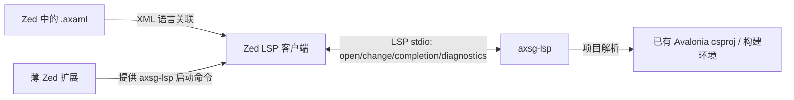

# Zed AXAML 补全与诊断可行性分析

调研日期：2026-10-12。目标仅为 Zed 内的 AXAML 补全与诊断；预览由另一份报告评估。本次只读检查公开文档和源码，未安装语言服务器、未创建 Zed 扩展，也未在用户的 Avalonia 项目上运行验收。

## 结论

**技术上可行，Zed 扩展 API 对 LSP 的支持足够；现成服务器需谨慎选型。** 当前 Zed 官方扩展注册表中没有 Avalonia/AXAML 条目，仍须制作一个接入扩展。[官方扩展注册表](https://github.com/zed-industries/extensions/blob/main/extensions.toml)、[Zed 语言扩展文档](https://zed.dev/docs/extensions/languages)

优先验证 AXSG 的独立 `axsg-lsp`。它的源码注册了补全能力，并且在打开/修改文档时计算、发布诊断。不能仅凭这些接口存在就宣称普通 Avalonia/XamlIl 项目上的语义诊断准确，必须在真实项目上对照 `dotnet build` 验证。`ls-for-avalonia` 可用作补全对照，但当前源码只注册补全与文本同步处理，未发现发布诊断处理；不适合直接作为“补全+诊断”双目标的完成方案。[AXSG LSP 源码](https://github.com/wieslawsoltes/XamlToCSharpGenerator/blob/81e747867ea818c55198cef94fb95f4a1498a25c/src/XamlToCSharpGenerator.LanguageServer/Server/AxsgLanguageServer.cs)、[社区 LSP 启动代码](https://github.com/SaverinOnRails/ls-for-avalonia/blob/cc8aed50c84b0711472a51af906f63e5c037/src/AvaloniaLSP/AvaloniaLanguageServer/Program.cs)

## 候选比较

| 候选 | 补全 | 诊断 | 安装和依赖 | 对本目标的判断 |
|---|---|---|---|---|
| AXSG `axsg-lsp` | `textDocument/completion` 和能力声明均已实现 | 编辑变化后调用分析引擎并发送 `textDocument/publishDiagnostics` | 独立 .NET Tool；检查的源码目标框架为 `net10.0` | 首选原型，重点核实常规 XamlIl 项目兼容性 |
| `ls-for-avalonia` | 已实现，依赖项目元数据与构建产物 | 当前检查的服务未见诊断处理 | README 要求 .NET SDK 9、递归克隆子模块、运行 `avalonia-solution-parser` 和构建项目 | 只能作为补全对照；若采用需补诊断和维护性修复 |
| 旧官方 Avalonia VS Code LSP | 旧版补全源码可参考 | 不应假定与新版官方工具等效 | 旧版源码位于 MIT 授权 `ARCHIVE` 分支，依赖旧补全引擎 | 参考实现，不推荐直接当成当前完整服务器 |

证据：[AXSG README 与工具安装](https://github.com/wieslawsoltes/XamlToCSharpGenerator)、[AXSG 启动项目](https://github.com/wieslawsoltes/XamlToCSharpGenerator/blob/81e747867ea818c55198cef94fb95f4a1498a25c/src/XamlToCSharpGenerator.LanguageServer/XamlToCSharpGenerator.LanguageServer.csproj)、[AXSG 语言服务选项](https://github.com/wieslawsoltes/XamlToCSharpGenerator/blob/81e747867ea818c55198cef94fb95f4a1498a25c/src/XamlToCSharpGenerator.LanguageService/XamlLanguageServiceOptions.cs)、[社区 LSP README](https://github.com/SaverinOnRails/ls-for-avalonia)、[社区 LSP 补全处理](https://github.com/SaverinOnRails/ls-for-avalonia/blob/cc8aed50c84b0711472a51af906f63e5c037/src/AvaloniaLSP/AvaloniaLanguageServer/Handlers/CompletionHandler.cs)、[旧官方源码](https://github.com/AvaloniaUI/AvaloniaVSCode/tree/ARCHIVE/src/AvaloniaLSP)。

AXSG 项目还提供另一套 source generator 编译后端。独立语言服务器本身是编辑器工具，不应为了试用补全就先修改用户应用的编译后端。然而其分析会调用 MSBuild/Roslyn 编译环境、Avalonia 语义层；对未经 AXSG 改造的项目，尤其 compiled binding、样式、资源及自定义控件诊断，准确程度尚未验证。普通 Avalonia 项目的 `dotnet build` 是判断错误真实性的基线。[AXSG 语言服务器入口](https://github.com/wieslawsoltes/XamlToCSharpGenerator/blob/81e747867ea818c55198cef94fb95f4a1498a25c/src/XamlToCSharpGenerator.LanguageServer/Program.cs)、[MSBuild 项目解析](https://github.com/wieslawsoltes/XamlToCSharpGenerator/blob/81e747867ea818c55198cef94fb95f4a1498a25c/src/XamlToCSharpGenerator.LanguageService/Workspace/MsBuildCompilationProvider.cs)、[编译后端选项](https://wieslawsoltes.github.io/XamlToCSharpGenerator/articles/reference/configuration-model/)。

`ls-for-avalonia` 有几个明确维护风险：服务源码把日志写到 `/home/noble/avalonia.log`；补全解析依赖临时目录中的解决方案元数据 JSON；补全项解析还返回名为 `avalonia.InsertProperty` 的 VS Code 客户端命令，这个命令不能预期 Zed 会实现。以上是代码事实；其在 macOS 上是否因此启动失败、补全是否受影响，需要运行验证。[启动代码](https://github.com/SaverinOnRails/ls-for-avalonia/blob/cc8aed50c84b0711472a51af906f63e5c037/src/AvaloniaLSP/AvaloniaLanguageServer/Program.cs)、[元数据读取](https://github.com/SaverinOnRails/ls-for-avalonia/blob/cc8aed50c84b0711472a51af906f63e5c037/src/AvaloniaLSP/AvaloniaLanguageServer/Models/Workspace.cs)、[补全处理](https://github.com/SaverinOnRails/ls-for-avalonia/blob/cc8aed50c84b0711472a51af906f63e5c037/src/AvaloniaLSP/AvaloniaLanguageServer/Handlers/CompletionHandler.cs)。

## Zed 接入路径

最小的接入扩展在 `extension.toml` 中把一个语言服务器注册到 `XML` 语言，并实现 `language_server_command` 返回本机 `axsg-lsp` 的路径与参数。Zed 的 XML 扩展默认仅关联 `.xml` 与 XML 声明，用户可在 `file_types` 中添加 `*.axaml`。这样可以先验证协议和语义，不用为初始原型编译一套新的 XML 语法树。正式发布时再决定是否提供独立的 AXAML 语言定义；Zed 的发布规则对新语言语法有额外要求。需在原型中确认 Zed 发出的 language ID、AXSG 是否接受该 URI/语言组合，以及多个 XML 相关服务器的优先级。[Zed LSP 扩展文档](https://zed.dev/docs/extensions/languages)、[Zed XML 扩展 README](https://github.com/sweetppro/zed-xml)、[扩展发布要求](https://zed.dev/docs/extensions/publishing/prerequisites)。

Zed 扩展不是 .NET LSP 本体，而是负责查找/安装二进制并返回启动命令。发布规则要求 LSP 不要随扩展打包，应通过已有环境或下载获取。原型可先要求用户安装 .NET 10 和 `axsg-lsp`，验证通过后再做版本固定、下载和升级逻辑。[Zed 扩展文档](https://zed.dev/docs/extensions/languages)、[发布要求](https://zed.dev/docs/extensions/publishing/prerequisites)。

## 最小验收实验

在隔离的普通 Avalonia 项目上，按以下顺序验收，不修改应用编译后端：

1. 安装或构建 `axsg-lsp`，确认进程通过标准输入输出完成 LSP `initialize`，没有非协议文本写入 stdout。
2. 安装 Zed XML 扩展，将 `*.axaml` 关联到 XML，再安装本地开发版桥接扩展。确认 Zed 日志能看到服务器启动、didOpen 和 didChange。
3. 在未保存文件中分别补全 Avalonia 控件、属性、枚举值、绑定/资源引用；比较内置与自定义控件。
4. 注入 XML 语法错误、未知控件/属性、错误绑定、缺失资源；核对 Zed 诊断位置和严重级别，并与 `dotnet build` 对照。修复后确认诊断消失。
5. 验证 App/Styles、UserControl、类库视图、多项目引用、中文或空格路径。观察初次项目加载时间、连续输入延迟、CPU/内存和诊断稳定性。

通过门槛：服务器稳定启动；AXAML 基础补全可用；至少 XML 错误与常见 Avalonia 语义错误能准确显示且修复后消失；普通 XamlIl 项目没有大量虚假报错。如果 AXSG 的语义诊断与 XamlIl 冲突，应保留可用的诊断类别，或考虑从 Avalonia 构建诊断另建桥接层，而不是把假阳性作为完成品发布。

粗略工作量属于工程估计：单人熟悉 Zed/Rust/.NET 的前提下，最小桥接与安装配置约 1–3 个工作日；真实项目兼容性实验约 3–5 日；若诊断需要针对普通 Avalonia 项目修复或重写，无法据静态调研给出可靠工期。

## 当前验证边界

- 已静态检查 Zed 扩展文档、XML 扩展说明、两个候选服务器的代码。社区 LSP 快照 `cc8aed50c84b0711472a51af906f63e5c037`（2025-08-21）；AXSG 快照 `81e747867ea818c55198cef94fb95f4a1498a25c`（2026-08-18）。
- 未运行 LSP 协议握手、Zed 插件或 Avalonia 示例项目，所以“支持补全和诊断”目前指服务器代码提供对应路径，不表示 Zed 中已验收可用。
- 先前的预览报告将 `ls-for-avalonia` 列为可用服务器候选，但本次针对诊断的源码检查缩小了它的适用范围：当前实现不能直接满足“补全+诊断”。
